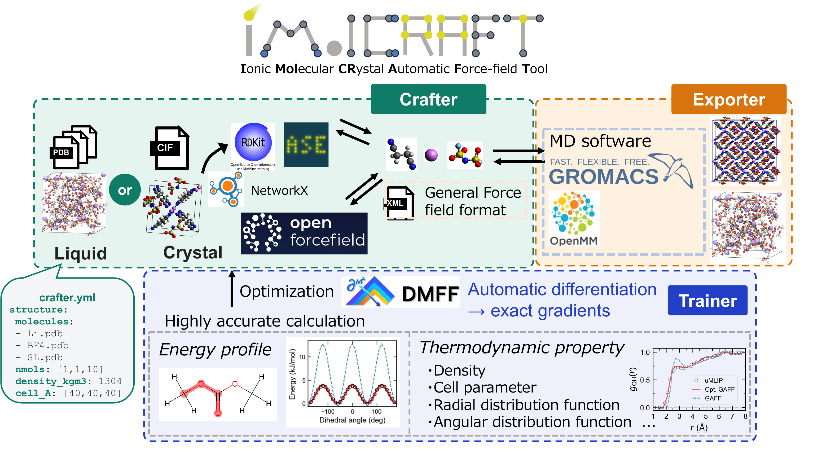

.. iMolCRAFT documentation master file, created by
   sphinx-quickstart on Wed Apr 30 15:45:17 2025.
   You can adapt this file completely to your liking, but it should at least
   contain the root `toctree` directive.

=======================
iMolCRAFT documentation
=======================

--------
Overview
--------
**iMolCRAFT** (**I**\ onic **Mol**\ ecular **CR**\ ystal **A**\ utomatic **F**\ orce-field **T**\ ool) is a Python package for automated force-field development, specialized in liquid electrolytes and molecular crystal electrolytes. It is built on `DMFF <https://github.com/deepmodeling/DMFF>`_ and JAX, OpenMM, GROMACS and Psi4.

* **Crafter**: extracts molecules from crystal structures or packs liquid boxes from PDB files, computes RESP charges and assigns GAFF parameters
* **Exporter**: writes GROMACS (and, experimentally, LAMMPS) input files
* **Calculator**: runs QM scans (Psi4 / Gaussian 16) and MD with OpenMM or GROMACS through one interface (``MDCalculator``)
* **Trainer**: optimizes force-field parameters by automatic differentiation against QM energy profiles (dihedral, distance) and against thermodynamic properties (density, cell parameters, RDF, ADF, ...) through MBAR reweighting, with post-hoc epoch selection from the validation history
* **Analyzer**: computes RDF, ADF, density, cell parameters and diffusion coefficients from MD trajectories

**iMolCRAFT** has been developed by `Ryoma Sasaki <https://srak-uf.github.io/>`_ at Institute of Science Tokyo, Japan, and is available under the MIT license.

.. toctree::
   :maxdepth: 2
   :caption: Main

   installation
   methods

.. toctree::
   :maxdepth: 2
   :caption: How to use

   crystal
   liquid
   exporter
   dihedral
   thermodyn_perturb

.. toctree::
   :caption: API Reference
   :hidden:
   :maxdepth: 2

   api/modules

